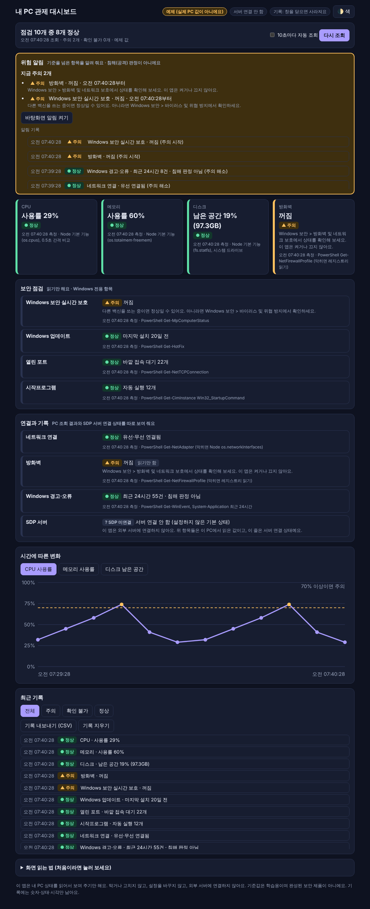

# 내 PC 관제 대시보드 (pc-control-dashboard)

내 **Windows PC**가 지금 건강한지 한 화면에 보여 주는 작은 프로그램입니다. CPU, 메모리, 디스크, 방화벽 같은 상태를 **읽기만** 해서 **정상 / 주의 / 확인 불가**로 알려 주고, 기준을 넘으면 **위험 알림**을 띄웁니다. 주의 기준은 **화면에서 직접 바꿀 수** 있습니다. (현재 **v0.2.0**, [바뀐 점](CHANGELOG.md))

핵심 기능은 3가지입니다: **① 기록 보기 → ② 내 PC 상태 → ③ 위험 알림.** 각각 지금 되는지, 한계가 무엇인지는 [`student/README.md`의 기능 점검표](student/README.md#1-기능-점검표-핵심-기능-3가지-지금-되는지-안-되는지)에 적었습니다.

> **먼저 알아 두세요.** 이 프로그램은 PC를 지켜 주거나 고쳐 주는 *보안 제품이 아닙니다.* 상태를 보여 주기만 하고, 설정을 바꾸지 않고, 인터넷의 다른 서버로 아무것도 보내지 않습니다.
> 또 Windows에서의 실제 동작은 아직 충분히 확인하지 못했습니다(아래 [검증 현황](#검증-현황-솔직하게) 참고).

## 이 저장소와 과제 제출본의 관계

| | 이 저장소 (포트폴리오용 독립 앱) | 과제 정식 완성본 |
| --- | --- | --- |
| 위치 | 이 저장소 `main` | 원래 저장소 [`choi-bujang-secret-vault`](https://github.com/zaqxsw108091-create/choi-bujang-secret-vault)의 **`final-assault` 브랜치** |
| 형태 | 따로 켜는 점검 앱 (`node student/server.mjs`) | 22단계 **케셰브 앱 안에 끼워 넣은 기능** (`on-client/student/extension.mjs`) |
| CPU·메모리·디스크·네트워크·방화벽·경고·오류 읽기 | **직접 만듦** | **케셰브 시작 틀 0.2.21의 제공 「내 PC 상태」를 씀** (다시 만들지 않음) |
| Windows 보안·업데이트 날짜·열린 포트·시작프로그램 | 있음 | 없음 (제공 서버 코드를 고치지 않는 규칙) |
| 기록·추이 비교·위험 알림 | 있음 (PC 파일에 저장) | 새로 구현 (이 브라우저에 저장) |
| 주의 기준 설정 화면 | 있음 (v0.2.0) | 없음 |
| CSV 내보내기 | 있음 | 없음 |
| 22단계 기능(로그인·기기·접속 판정·AI 설명) | 없음 | 그대로 포함 |

- 과제 제출은 **원래 저장소의 `final-assault` 브랜치 커밋**으로 합니다. 제공 기능과 내가 만든 기능을 나눠 적은 정리 문서는 [`docs/kesheb-final-assault.md`](docs/kesheb-final-assault.md)(원래 저장소 `docs/FINAL_ASSAULT.md`의 사본)에 있습니다.
- 이 저장소의 앱은 독립 실행 버전이라 포트폴리오로 따로 남깁니다. 아래 설명은 모두 **이 독립 앱** 기준입니다.



*위 화면은 "예제 모드"의 가짜 값입니다. 실제 PC 값이 아닙니다.*

---

## Windows에서 쓰는 법 (최신 버전 받기)

이 앱은 **Windows 10 / 11** 기준입니다. 설치 프로그램이 아니라, 받아서 더블클릭으로 켭니다.

**처음 받을 때**

1. 이 저장소 첫 화면(https://github.com/zaqxsw108091-create/pc-control-dashboard)에서 초록색 **`<> Code` → `Download ZIP`** 을 누릅니다. 항상 **최신 버전**(`main`)이 받아집니다.
2. 받은 ZIP을 **마우스 오른쪽 → 모두 압축 풀기**. (ZIP 안에서 바로 실행하지 마세요)
3. [Node.js](https://nodejs.org) **LTS**를 설치합니다. (이미 있으면 생략. 확인: `cmd`에서 `node -v`)
4. 압축 푼 폴더의 `student` 안에서 **`start-demo.bat`** 더블클릭 → 예제 화면 확인 → 이어서 **`start.bat`** 더블클릭 → 내 PC 상태.
5. 끌 때는 검은 창을 닫으면 됩니다.

**최신 버전으로 업데이트할 때**

- **ZIP으로 받았다면:** 위 1~2를 다시 합니다(새 폴더에 풀기). 예전 조회 기록을 가져오려면 옛 폴더의 `student\data` 폴더를 새 폴더의 `student` 안에 복사하세요. 기록이 필요 없으면 그냥 새 폴더를 쓰면 됩니다.
- **Git을 쓴다면:** 폴더에서 `git pull`.
- 지금 어느 버전인지는 화면 맨 아래의 `v0.2.0` 같은 표시, 또는 [바뀐 점](CHANGELOG.md)에서 확인합니다.

**평가·시연용 빠른 순서:** `start-demo.bat`(예제로 화면 구성 보기) → "다시 조회" 몇 번 → "주의 기준 바꾸기"에서 CPU 기준을 낮추고 저장 → 위험 알림이 뜨는지 확인 → `start.bat`(내 PC 실제 값). 막히면 아래 [문제가 생겼을 때](#문제가-생겼을-때)를 보세요.

---

## 1분 요약

1. 이 저장소를 **ZIP으로 받아 압축을 풉니다.**
2. **Node.js**가 없으면 설치합니다. (설치 권한이 없으면 [설치 없이 쓰는 방법](#nodejs를-설치할-수-없을-때-학원공용-pc)이 있어요)
3. 폴더의 `student` 안에 있는 **`start-demo.bat`** 을 더블클릭 → 예제 화면이 뜹니다.
4. 잘 뜨면 **`start.bat`** 을 더블클릭 → 내 PC의 실제 상태가 뜹니다.

---

## 처음부터 따라 하기 (Windows 10 / 11)

### 1단계. 프로그램 받기

1. 이 페이지 오른쪽 위의 초록색 **`<> Code`** 버튼을 누릅니다.
2. **Download ZIP** 을 누릅니다.
3. 받은 `pc-control-dashboard-main.zip` 파일을 **마우스 오른쪽 클릭 → 모두 압축 풀기** 로 풉니다.
   - ZIP 안에서 바로 실행하지 마세요. 반드시 **압축을 푼 폴더**에서 실행해야 합니다.

(Git을 쓸 줄 안다면 `git clone https://github.com/zaqxsw108091-create/pc-control-dashboard` 도 됩니다.)

### 2단계. Node.js 있는지 확인하기

Node.js는 이 프로그램을 돌려 주는 도구입니다.

1. 키보드의 **Windows 키**를 누르고 `cmd` 라고 입력한 뒤 Enter.
2. 검은 창에 `node -v` 를 입력하고 Enter.
3. `v22.x.x` 처럼 숫자가 나오면 준비 끝입니다. **22 이상을 권장**합니다. (18.15 이상이면 켜지게 만들었지만 시험은 22에서만 했습니다.)
4. "인식되지 않습니다"라고 나오면 설치가 필요합니다.

**설치:** https://nodejs.org 에서 **LTS** 버튼으로 받아 설치합니다. 설치 후 `cmd` 창을 *새로* 열어 `node -v` 를 다시 확인하세요.

### 3단계. 예제로 먼저 켜 보기

압축을 푼 폴더에서 `student` 폴더를 열고 **`start-demo.bat`** 을 더블클릭합니다.

- 검은 창이 뜨고, 잠시 뒤 브라우저에 대시보드가 열립니다.
- 화면 위쪽에 **"예제 (실제 PC 값이 아니에요)"** 라고 표시됩니다. 이게 보이면 프로그램은 정상으로 켜진 것입니다.
- 검은 창을 닫으면 프로그램이 꺼집니다.

> **"Windows의 PC 보호" 파란 창이 뜰 때:** 인터넷에서 받은 `.bat` 파일에 Windows가 경고하는 정상적인 동작입니다. 믿을 수 있는 곳에서 받았는지 먼저 생각하세요. 파일 내용이 궁금하면 `start.bat` 을 **메모장**으로 열어 읽어 볼 수 있습니다(몇 줄 안 됩니다). 학원·회사 PC라면 관리자 규정을 먼저 확인하세요. 경고를 피하려고 보안 설정을 끄지 마세요.

### 4단계. 내 PC 상태 보기

`student` 폴더의 **`start.bat`** 을 더블클릭합니다. 카드 4개와 보안 점검 4개가 나타납니다. **"다시 조회"** 를 누를 때마다 시각과 결과가 기록되고 그래프가 이어집니다.

### 여러 사람이 쓰는 PC(학원 등)라면

**`start-shared.bat`** 으로 켜세요. 조회 기록을 파일에 남기지 않고, 창을 닫으면 사라집니다.

---

## Node.js를 설치할 수 없을 때 (학원·공용 PC)

설치 권한이 없어도, 압축만 풀어서 쓸 수 있습니다.

1. https://nodejs.org/en/download 에서 **Windows Binary (.zip)** 을 받습니다.
2. 압축을 풀고, 안에 있는 파일들을 이 프로그램의 **`student\node`** 폴더로 옮깁니다. (`student\node\node.exe` 가 있어야 합니다. `node` 폴더가 없으면 새로 만드세요.)
3. `student\start.bat` 을 더블클릭합니다. `start.bat` 이 `student\node\node.exe` 를 먼저 찾아 씁니다.

PC에 설치되거나 설정이 바뀌는 것은 없습니다.

---

## 화면 읽는 법

| 표시 | 뜻 |
| --- | --- |
| ● **정상** (초록) | 기준 안에 있어요 |
| ▲ **주의** (노랑) | 한 번 살펴보세요. 문제가 있다는 *확정*이 아니라 기준을 넘었다는 뜻이에요 |
| ? **확인 불가** (회색) | 값을 읽지 못했어요. 이유가 함께 적혀요. **정상이라는 뜻이 아니에요** |

**위험 알림:** 기준을 넘은 항목(▲ 주의)이 생기면 화면 위쪽 상자와 알림 기록에 시작·해소 시각이 나오고, 브라우저 탭 제목에 `(!2)`처럼 표시됩니다. 원하면 "바탕화면 알림 켜기"를 눌러 새로 주의가 생길 때 알림을 받을 수 있어요. **기준을 넘었다는 알림일 뿐 침해(공격)를 판정하지 않으며**, 이 창이 열려 있고 조회할 때만 감지합니다.

**읽지 못한 항목 상자:** 값을 읽지 못한 항목, 이유, 다음 행동을 알려 줍니다(예: "권한을 확인한 뒤 다시 조회를 눌러 주세요").

**맨 위 카드 4개:** CPU(두뇌가 바쁜 정도), 메모리(작업 공간이 찬 정도), 디스크(저장 공간이 남은 정도), 방화벽(바깥 침입을 막는 문지기가 켜져 있는지). 카드마다 **몇 시에, 어디서 읽었는지**가 적혀 있어요.

**보안 점검 4개:** Windows 보안 실시간 보호, Windows 업데이트(마지막 설치일), 열린 포트(바깥 접속을 기다리는 문의 개수), 시작프로그램(켤 때 같이 켜지는 프로그램 개수).

**연결과 기록:** 네트워크 연결(유선/무선), 방화벽(읽기만 함), Windows 경고·오류 건수(최근 24시간, 침해 판정 아님), SDP 서버(기본 상태는 "SDP 미연결 · 서버 연결 안 함").

**그 아래:** 시간에 따른 변화 그래프(CPU·메모리·디스크 선택, 최근·평균·최저·최고 표시), 최근 기록(전체/주의/확인 불가/정상으로 거르기), **기록 내보내기(CSV)**, **기록 지우기**(확인 창을 거침, 공용 PC에서 쓰고 나서 지우는 용도).

**자동 조회:** 체크하면 10초/30초/1분/5분 간격으로 자동 조회합니다(고른 값은 이 브라우저가 기억). "방금 / 12초 전"으로 마지막 조회가 얼마나 지났는지 보입니다. 알림 기록에는 주의가 **얼마나 이어졌는지**도 나옵니다.

**주의 기준 바꾸기(설정):** 페이지 아래 "주의 기준 바꾸기"를 열어 숫자를 고치고 **저장하고 다시 조회**를 누르면 새 기준으로 판정합니다. 범위를 벗어난 값은 입력칸에서 바로 알려 줍니다. "처음 값으로 되돌리기"도 있어요. 이미 쌓인 기록의 상태는 바뀌지 않고 다음 조회부터 적용됩니다. 설정은 `student/data/settings.json`에 저장되며(예제 모드·`--no-save`에서는 저장하지 않음) 코드를 열 필요가 없습니다.

**화면 색:** 항상 **어두운 화면이 기본**이고(윈도우 밝은 모드를 따라가지 않아요), "색" 버튼으로 밝은 화면으로 바꿀 수 있어요.

주의로 바뀌는 기준(처음 값. 위 설정 화면이나 `student/judge.mjs`에서 바꿀 수 있어요. 방화벽·Windows 보안·네트워크 항목은 켜짐/꺼짐이라 숫자 기준이 없어요):

| 항목 | 주의 기준 |
| --- | --- |
| CPU | 사용률 70% 이상 |
| 메모리 | 사용률 80% 이상 |
| 디스크 | 남은 공간 15% 이하 |
| 방화벽 | 도메인·개인·공용 중 하나라도 꺼짐 |
| Windows 보안 실시간 보호 | 꺼짐 (다른 백신을 쓰면 정상일 수 있어요) |
| Windows 업데이트 | 마지막 설치가 60일보다 오래됨 |
| 열린 포트 | 바깥 접속 대기 40개 초과 (개수만 세며 위험 판단은 아님) |
| 시작프로그램 | 15개 초과 |
| 네트워크 연결 | 연결 안 됨 |
| Windows 경고·오류 | 최근 24시간 100건 초과 (침해 판정 아님) |

이 기준은 학습용으로 정한 값이며 공식 보안 기준이 아닙니다.

---

## 문제가 생겼을 때

| 증상 | 해결 |
| --- | --- |
| "Node.js를 찾지 못했어요"가 나옴 | 위 [2단계](#2단계-nodejs-있는지-확인하기)로 설치하거나, [설치 없이 쓰는 방법](#nodejs를-설치할-수-없을-때-학원공용-pc)을 쓰세요 |
| 브라우저가 안 열림 | 검은 창에 적힌 주소(예: `http://127.0.0.1:4173`)를 브라우저 주소창에 직접 붙여 넣으세요 |
| "포트를 이미 쓰고 있어요" | 자동으로 다음 번호를 찾습니다. 검은 창에 나온 *실제 주소*를 여세요 |
| 카드가 **확인 불가**로 나옴 | 카드에 적힌 이유를 읽어 보세요. 관리자 권한이 없거나 PowerShell이 막힌 PC에서는 일부 항목이 읽히지 않을 수 있어요. 아래 "원인 찾기"를 해 보세요 |
| `.ps1` 실행이 막힘 | `.ps1` 대신 `.bat` 을 쓰세요. 실행 정책 같은 PC 설정은 바꾸지 않아도 됩니다 |
| 학원·회사 보안 프로그램이 막음 | 우회하지 말고 관리자에게 문의하세요 |
| 화면이 안 열리고 오류만 나옴 | 검은 창의 첫 오류 문구를 복사해 [Issues](https://github.com/zaqxsw108091-create/pc-control-dashboard/issues)에 남겨 주세요 |

**원인 찾기(글자로 한 번만 조회):** 압축을 푼 폴더에서 `cmd` 를 열고 아래를 실행하면, 화면 없이 결과와 이유를 글자로 보여 줍니다. (기록은 남기지 않아요.)

```
node student\check-once.mjs
```

---

## 이 프로그램이 하는 일 / 하지 않는 일

**하는 일**
- CPU·메모리·디스크 값을 읽습니다.
- PowerShell의 *조회* 명령(`Get-NetFirewallProfile`, `Get-MpComputerStatus`, `Get-HotFix`, `Get-NetTCPConnection`, `Get-CimInstance`, `Get-NetAdapter`, `Get-WinEvent`)으로 방화벽·Windows 보안·업데이트·포트·시작프로그램·네트워크·경고·오류 건수를 읽습니다. 방화벽 조회가 막히면 레지스트리의 설정값을 읽기만 하는 방법으로 한 번 더 시도합니다.
- 숫자·상태·시각만(IP·MAC·이벤트 내용은 제외) `student/data/` 폴더에 기록합니다(최근 약 500건, `--no-save` 로 끌 수 있음).
- 화면은 내 PC 안(`127.0.0.1`)에서만 열립니다. 다른 주소로 들어온 요청은 거절합니다.

**하지 않는 일**
- 막기, 차단, 치료, 설정 변경을 하지 않습니다. 방화벽을 켜거나 끄지도 않습니다.
- 외부 서버에 연결하지 않습니다. 화면에 항상 "서버 연결 안 함"이 표시됩니다.
- PC 이름, 사용자 이름, 프로그램 이름, 파일 이름, 비밀번호, API 키를 수집·저장하지 않습니다.
- 설치 프로그램(`setup.exe`)이 아닙니다. `start.bat` 은 설치가 아니라 켜는 단축 파일입니다.

---

## 검증 현황 (솔직하게)

| 항목 | 상태 |
| --- | --- |
| 판정 규칙, 위험 알림 계산, 기록, 서버, 설정 저장·검증, 거부 동작 자동 시험 38건 | 개발 환경(Linux)에서 통과 |
| 브라우저 자동 조작 시험(조회·설정 저장/오류/되돌리기·그래프·CSV·자동 조회 기억·테마·키보드·모바일, 콘솔 오류 0건) | 개발 환경(Linux, Chromium)에서 통과 |
| GitHub Actions(Ubuntu·**Windows**)에서 자동 시험 38건과 실제 조회 | **둘 다 통과.** Windows 서버(`windows-latest`)에서 방화벽·Windows 보안·업데이트·포트·시작프로그램·네트워크·경고/오류 **PowerShell 조회가 진짜로 값을 읽음**을 확인 (결과는 저장소 Actions 탭) |
| 브라우저 화면(데스크톱·모바일, 어두운/밝은 색) | 개발 환경(Linux)에서 오류 없이 확인 |
| 예제 모드, 포트 자동 찾기, `--no-save`, 위험 알림 상자·읽지 못한 항목 상자 | 개발 환경(Linux)에서 확인 |
| 안내 문장대로 빈 폴더(ZIP을 푼 것처럼)에서 따라 하기 | 개발 환경(Linux)에서 안내 순서대로 실행해 확인 (예제 켜기, 글자 조회, 화면 응답) |
| **실제 다른 사람이 Windows에서 이 안내만 보고 따라 하기** | **아직 못 해 봄** |
| Windows PowerShell 명령의 **진짜 출력** | **GitHub의 Windows 서버에서는 확인함.** 다만 이는 일반 사용자 PC가 아니라 CI 서버(예: Windows 보안 실시간 보호가 "꺼짐"으로 나옴)라서, 내 PC에서도 같은지는 **아직 모름** |
| `start.bat` / `start.ps1` / 휴대용 Node 방식 | **Windows에서 직접 확인하지 못함** |
| CPU·메모리·디스크 값이 Windows 작업 관리자와 맞는지 | **확인하지 못함** (메모리는 조금 다를 수 있음) |

Windows에서 써 보고 안 되는 부분을 알려 주시면 고치겠습니다.

---

## 앞으로 고칠 계획

우선순위 순서입니다. 아직 *하지 않은* 일이고, 약속이 아니라 계획입니다.

1. **Windows 실제 검증**: 실제 Windows PC에서 각 항목이 제대로 읽히는지 확인하고, 안 되는 항목을 고칩니다. (GitHub Actions의 Windows 자동 시험은 v0.2.0에서 추가했습니다. 다만 CI 서버는 일반 PC와 다릅니다.)
2. **확인 불가 줄이기**: 관리자 권한이 없을 때 읽을 수 있는 다른 방법을 찾고, 권한 때문이라면 화면에 "관리자로 실행하면 보일 수 있어요"처럼 더 친절하게 안내합니다.
3. ~~기준값 설정 화면~~ → **v0.2.0에서 완료**. 앞으로는 항목별 켜고 끄기를 검토합니다.
4. **알림 다듬기**: 같은 주의가 계속될 때 알림을 줄이고, 알림이 필요한 항목을 고를 수 있게 합니다.
5. **기록 보기 확장**: 하루·일주일 단위로 모아 보기, 기록 파일 나누기.
6. **설치형 배포**: 설치 프로그램(`setup.exe`)으로 만들어 Node.js 없이 쓸 수 있게 합니다. (보안 경고와 서명 문제를 먼저 살펴봐야 합니다.)
7. **위험 알림 확장**: 앱을 꺼 둔 동안에도 감지하는 방법(백그라운드 실행)을 검토합니다. 지금은 앱이 켜져 있고 조회할 때만 감지합니다.
8. **Mac / Linux 지원**: 방화벽 등 운영체제별 읽기 방법을 추가합니다. 지금은 CPU·메모리·디스크만 읽히고 나머지는 "확인 불가"입니다.
9. 화면 영어 지원, 라이선스 정하기, 스크린샷을 실제 Windows 화면으로 교체.

---

## 개발자용

```
npm test                              # 자동 시험 38건 (node --test "test/*.test.mjs")
node student/server.mjs --demo        # 예제 모드 (--port=4200, --no-save, --open 사용 가능)
```

| 파일 | 역할 |
| --- | --- |
| `student/server.mjs` | 내 PC 안에서만 열리는 서버 |
| `student/collect.mjs` | PC 상태 읽기(읽기 전용 명령만) |
| `student/judge.mjs` | 정상/주의/확인 불가 판정과 기준값 |
| `student/alerts.mjs` | 위험 알림(주의 시작·해소) 계산 |
| `student/store.mjs` | 조회 기록 저장 |
| `student/settings.mjs` | 주의 기준 검사·저장 |
| `student/demo.mjs` | 예제 값 |
| `student/public/index.html` | 화면 |
| `student/check-once.mjs` | 글자로 한 번 조회 |
| `student/start*.bat`, `start.ps1` | 켜는 단축 파일 |

자세한 내용은 [`student/README.md`](student/README.md) 도 보세요.

이 프로그램은 "2026 KIT K-뉴딜 SKT ALEPH 공동 방어전"의 마지막 과제를 하며 먼저 만든 **독립 실행 버전**입니다. 같은 코드가 과제용 저장소 `choi-bujang-secret-vault`의 `main` 브랜치 `student/` 폴더에도 사본으로 있지만, **과제 정식 완성본은 그 저장소의 `final-assault` 브랜치**(케셰브 앱 안에 끼워 넣은 형태)입니다.
